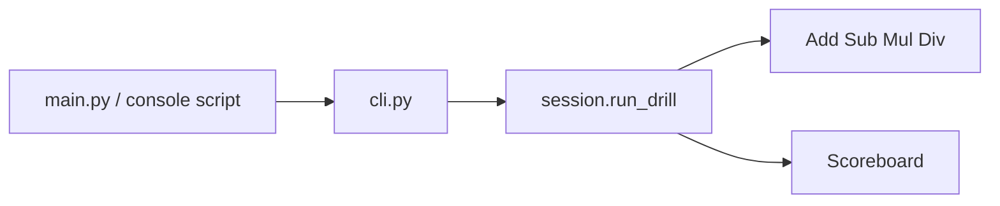

# Requirements

### Overview & Goals
Split the single-file Click drills in `main.py` into a small installable package so `dodawanie` and `mnozenie` stay the same for users, while + / - / * / / become first-class operations that a shared session can run.

This pass is **structure only**: no MAX flag, no batch-of-20, no mixed-operation command. Those TODOs stay future work, but the new APIs should accept them without another rewrite.

### Scope
#### In Scope
- Extract add, subtract, multiply, and divide into operation objects with the same question generation as today (including non-negative subtract and exact divide).
- One shared drill session for the infinite loop, `click.prompt`, coloured feedback, Ctrl+C (`Abort`) summary, and per-operation scores.
- Keep the Click group, the `name` greeting, and both subcommands with the current Polish copy (including existing typos such as "dodawnia" / "Dodawnia").
- Move code under `src/tabliczka/`, add a console script, and keep a thin root `main.py` so `python main.py <name> dodawanie` still works.

#### Out of Scope
- CLI for MAX / operand range (default `1..10` stays hardcoded, but `generate` will take a max so it can be wired later).
- Asking 20 questions at once or any non-infinite session mode.
- A unified command that mixes `+,-,*,/` in one run.
- Fixing scoreboard quirks (per-op "źle" is gated on **total** `bad`, not that op's `bad`) or copy typos — behaviour is preserved.

### User Stories
- As a learner, I want `dodawanie` and `mnozenie` to work as they do now so I can keep practising without new flags or commands.
- As a maintainer, I want each arithmetic skill in one place so a later mixed-ops command only passes a different list of operations.

### Functional Requirements
- `tabliczka <name> dodawanie` greets, then randomly drills add and subtract until Ctrl+C, then prints total and per-skill scores.
- `tabliczka <name> mnozenie` does the same for multiply and divide.
- Subtract questions remain of the form `(x+y)-x`; divide remains ` (x*y):x ` so answers are always positive integers in 1..10.
- Wrong-answer text still shows the correct value in red; correct answers still print green "Dobrze!".

### Non-Functional Requirements
- Python ≥ 3.15, Click ≥ 8.5, `src/` layout via Hatchling, no new runtime dependencies.

# Technical Design

### Current Implementation
`main.py` is a Click group with argument `name` and two subcommands whose bodies are copies of the same loop: pick a boolean, `randint(1, 10)` twice, prompt, update a nested `ok`/`bad` dict, on `click.Abort` print totals then two sections. Internal keys are `add` / `substract` / `multiplication` / `division`.

### Key Decisions
- **Operation objects + one session** (chosen): each of +,-,*,/ implements a small protocol; commands only choose which operations to pass. Later mixed ops is `run_drill([ADD, SUB, MUL, DIV])`; later MAX is an argument on `generate`; later batch mode is a session parameter, not a new drill class.
- **`src/tabliczka/` + console script** (chosen): installable CLI; Hatchling `src` layout; keep root `main.py` as a one-liner for the current `python main.py` workflow.
- **Preserve generation and scoreboard quirks** so this pass is a behaviour-neutral extract.

### Proposed Changes
Introduce a `Question` + `Operation` protocol. `Add`, `Subtract`, `Multiply`, `Divide` each know their `id`, scoreboard heading, prompt text, and how to build a `Question` from two operands in `[1, max_n]` (default `max_n=10`).

`Scoreboard` records `ok`/`bad` per operation id and prints the existing summary (grand total, then one section per operation, `if bad:` still using the **total** wrong count).

`run_drill(operations)` loops: `choice(operations)`, `generate()`, `click.prompt(..., type=int)`, colour feedback, until `Abort`.

`cli.py` owns the Click group; `dodawanie` passes `[ADD, SUBTRACT]`, `mnozenie` passes `[MULTIPLY, DIVIDE]`. Intro echoes stay on the commands.

### Data Models / Contracts
```python
@dataclass(frozen=True)
class Question:
    prompt: str  # e.g. "Dodawanie: Ile to 3+4?"
    answer: int
    operation_id: str  # "add" | "substract" | "multiplication" | "division"


class Operation(Protocol):
    id: str
    heading: str  # scoreboard section title, e.g. "Odejmowanie:"

    def generate(self, min_n: int = 1, max_n: int = 10) -> Question: ...


class Scoreboard:
    def record(self, operation_id: str, correct: bool) -> None: ...
    def print_summary(self, operations: Sequence[Operation]) -> None: ...


def run_drill(
    operations: Sequence[Operation], *, min_n: int = 1, max_n: int = 10
) -> None: ...
```

Subtract must generate `minuend = x+y`, prompt `{minuend}-{x}`, answer `y`. Divide must generate `product = x*y`, prompt `{product}:{x}`, answer `y`.

### File Structure
**Added**
- `src/tabliczka/__init__.py` — package version/marker
- `src/tabliczka/__main__.py` — `python -m tabliczka`
- `src/tabliczka/operations.py` — `Question`, protocol, four operations, exported singletons
- `src/tabliczka/session.py` — `Scoreboard` + `run_drill`
- `src/tabliczka/cli.py` — Click group and the two commands
- `tests/test_operations.py` — generation invariants
- `tests/test_session.py` — scoring / summary gating

**Modified**
- `main.py` — `from tabliczka.cli import main` then `main()`
- `pyproject.toml` — Hatchling build, `[project.scripts] tabliczka = "tabliczka.cli:main"`, pytest as a dev extra

### Architecture Diagram


Commands never generate questions themselves. Session never hard-codes which pair of skills is active.

### Risks
- Naive `x-y` / `x/y` would change the exercise difficulty; generation must copy the current identities.
- Changing the `if bad:` gate would alter the Ctrl+C screen; keep it.
- Without a build backend, `src/` is not importable; Hatchling + editable install (uv) must be part of the packaging change.

# Testing

### Validation Approach
Unit-test operations and scoring without the terminal. Smoke the Click group with `click.testing.CliRunner` so both subcommands still exist and greet. Do not try to drive the infinite prompt loop in CI beyond a mocked `Abort`.

### Key Scenarios
- Add question: prompt `Dodawanie: Ile to {x}+{y}?`, answer `x+y`.
- Subtract question: operands `x,y` in 1..10, prompt uses `x+y` and `x`, answer is `y` (≥ 1).
- Multiply / divide analogously; divide answer is always an integer `y`.
- Scoreboard: 2 add-ok + 1 sub-bad prints total 2 green / 1 red, then both sections; per-op "źle" lines appear because total `bad` is truthy.
- `CliRunner.invoke(main, ["Ala", "dodawanie"])` starts the add drill (intro text) and `mnozenie` starts the mul drill; greeting contains `Witaj Ala!`.

### Edge Cases
- `max_n` default 10; calling `generate(max_n=5)` never yields operands outside 1..5 (hook for later MAX, not exposed on CLI).
- Empty drill (0 questions, immediate Abort): totals 0, no red "źle" lines (`if bad:` is false).
- Operation `id` values stay `add` / `substract` / `multiplication` / `division` so headings match today.

### Test Changes
- Add `pytest` as a project dev dependency.
- `tests/test_operations.py` — many `generate()` samples for all four ops.
- `tests/test_session.py` — `Scoreboard.record` + `print_summary` with Click output capturing; `run_drill` with patched `click.prompt` then `Abort`.

# Delivery Steps

### ✓ Step 1: Create src package and operation objects
The four drills exist as Operation objects under `src/tabliczka/` with the same prompts and answers as `main.py`.

- Add Hatchling `[build-system]`, `[project.scripts] tabliczka = "tabliczka.cli:main"`, and a pytest dev extra in `pyproject.toml`.
- Create `src/tabliczka/__init__.py` and `operations.py` with `Question`, `Operation`, and singletons `ADD`, `SUBTRACT`, `MULTIPLY`, `DIVIDE`.
- Implement subtract as `(x+y)-x` and divide as `(x*y):x`; `generate(min_n=1, max_n=10)` is the only range API (no CLI flag).
- Keep operation ids `add` / `substract` / `multiplication` / `division` and the current Polish prompt prefixes.
- Add `tests/test_operations.py` covering prompt shape, answer, and operand bounds.

### ✓ Step 2: Extract shared session and scoreboard
`run_drill` owns the infinite loop, feedback, Ctrl+C handling, and score printing for any list of operations.

- Add `src/tabliczka/session.py` with `Scoreboard` and `run_drill(operations, *, min_n=1, max_n=10)`.
- Loop: `choice(operations)`, `generate()`, `click.prompt(..., type=int)`, green/red echoes, `record`.
- On `click.Abort`, print the same banner layout as today; gate per-op "źle" on **total** `bad`.
- Headings come from each operation (`Dodawnia:`, `Odejmowanie:`, `Mnożenie:`, `Dzielenie:`).
- Add `tests/test_session.py` for summary text and a mocked prompt-then-Abort path.

### ✓ Step 3: Wire Click commands and thin entry points
`dodawanie` and `mnozenie` behave as before, now calling `run_drill` from a real package entry.

- Add `src/tabliczka/cli.py` with the existing group (`name` argument + `Witaj {name}!`) and both subcommands; intro sentences stay on the commands.
- `dodawanie` → `run_drill([ADD, SUBTRACT])`; `mnozenie` → `run_drill([MULTIPLY, DIVIDE])`.
- Add `src/tabliczka/__main__.py`; shrink root `main.py` to import and call `tabliczka.cli.main`.
- CliRunner smoke tests for greeting + command intro text; confirm `python main.py` and the `tabliczka` script still resolve.
